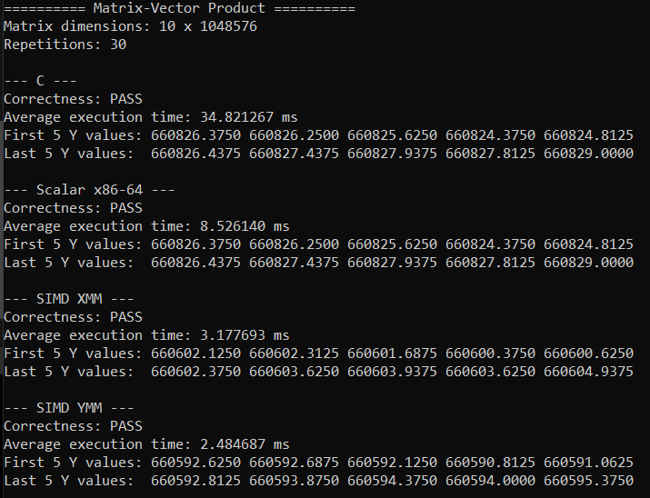
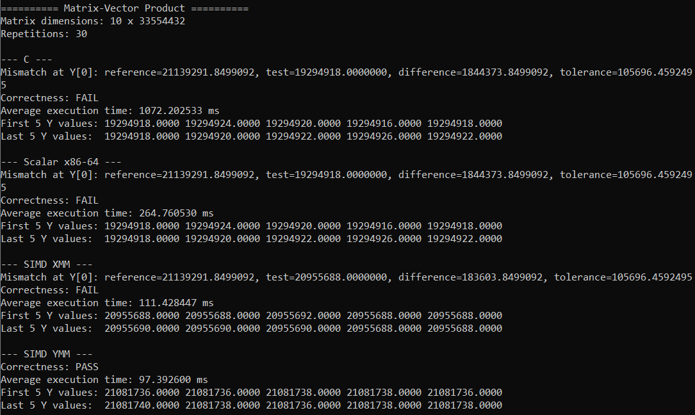
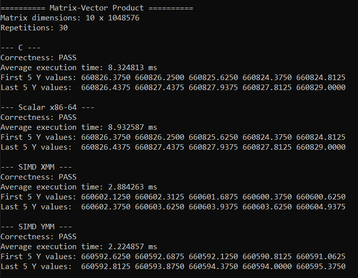
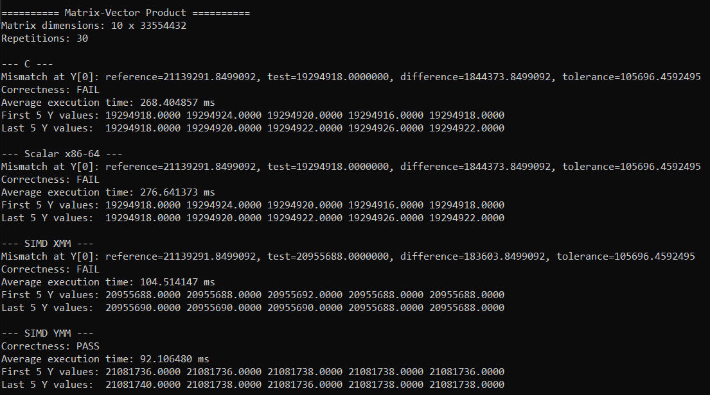
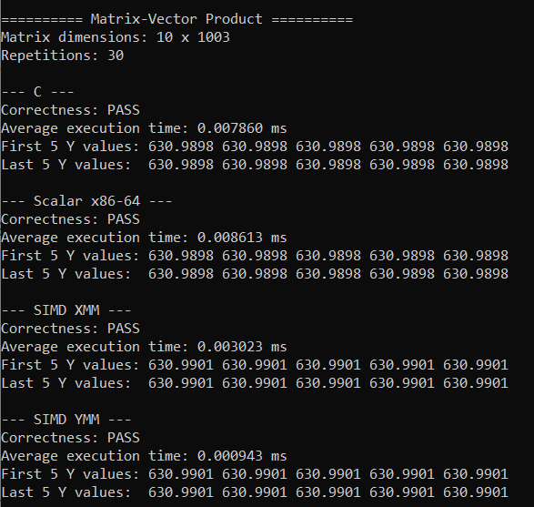

# SIMD Programming Project: Matrix-Vector Product

## 1. Project Overview

This project implements and compares matrix-vector multiplication using four approaches:

1. C implementation — a baseline implementation using standard nested loops.
2. Scalar x86-64 assembly — an assembly implementation that processes one element at a time.
SIMD XMM assembly — uses 128-bit XMM registers to process four single-precision floating-point elements per vector instruction.
SIMD YMM assembly — uses 256-bit YMM registers to process eight single-precision floating-point elements per vector instruction.


The operation computes the product of a matrix \(A\) and a vector \(X\), producing an output vector \(Y\):

$$
Y_i = \sum_{j=0}^{n-1} A_{ij}X_j
$$

The implementations are evaluated based on execution time, speedup, numerical accuracy, and their ability to handle input sizes that are not multiples of the SIMD vector width.

## 2. Experimental Setup

* **Programming languages:** C and x86-64 assembly
* **SIMD instruction sets:** XMM (128-bit) and YMM (256-bit)
* **Development environment:** Visual Studio, x64 configuration, and NASM
* **Data type:** Single-precision floating-point (`float`) for the four measured kernels
* **Reference implementation:** Double-precision accumulation (`double`)
* **Benchmarking:** Windows `QueryPerformanceCounter`
* **Repetitions:** 30 repetitions per kernel
* **Matrix dimensions:** \(m=10\) rows, with varying numbers of columns \(n\)

The matrix contains \(m \times n\) elements, and the input vector contains \(n\) elements. The matrix is stored as a contiguous one-dimensional array in row-major order.

The input values follow repeating patterns to make the experiments reproducible.

### Matrix and Vector Initialization

The matrix (A) and input vector (X) are initialized using deterministic, repeating numerical patterns rather than randomly generated values. This ensures that the same input data is used across the four implementations, making performance and numerical accuracy comparisons more consistent.

The matrix is stored as a one-dimensional array in row-major order. Each element is initialized using the following expression:

```c
for (size_t i = 0; i < m * n; i++)
    A[i] = (float)((i % 17) + 1) * 0.1f;
```

The expression uses the remainder of the array index modulo 17 to generate repeating values. The matrix elements cycle through values approximately ranging from 0.1 to 1.7.

The input vector is initialized using a similar pattern:

```c
for (size_t i = 0; i < n; i++)
    X[i] = (float)((i % 13) + 1) * 0.1f;
```


The vector elements cycle through values approximately ranging from 0.1 to 1.3.

### Test cases

| Test case           | Number of columns (\(n\)) | Purpose                                                                                |
| ------------------- | ------------------------: | -------------------------------------------------------------------------------------- |
| Small boundary test |                     1,003 | Tests SIMD processing when the number of elements is not divisible by the vector width |
| Case 1              |    $2^{20}$ = 1,048,576 | Measures performance on a large input                                                  |
| Case 2              |   $2^{25}$ = 33,554,432 | Measures performance on a substantially larger input                                   |
| Additional cases    |               To be added | Results from further experiments, if available                                         |

The rectangular matrix dimensions were chosen to keep the memory requirements manageable while testing large vector lengths.

## 3. Program Output

### Execution Times and Correctness Checks 

The following screenshots show the execution times and correctness checks for the different test cases on the C, scalar x86-64, SIMD XMM, and SIMD YMM implementations on both Debug and Release configurations in Visual Studio. 

#### Debug Version
#### $n = 2^{20}$


#### $n = 2^{25}$


`[INSERT SCREENSHOT: EXECUTION TIMES FOR 2^30]`

#### Release Version

#### $n = 2^{20}$


#### $n = 2^{25}$


`[INSERT SCREENSHOT: EXECUTION TIMES FOR 2^30]`


The Release version runs significantly faster than the Debug version because it enables compiler optimizations that reduce execution time. The Debug version prioritizes debugging and error detection rather than performance. Therefore, the Release results are used for the performance comparison of the four implementations.

### Correctness Checking and Tolerance

The correctness check usese a relative tolerance of 0.5% (0.005). For each output element, the absolute difference between the reference and tested result is calculated:

$$
\text{Difference}_i =
\left|Y_{\text{reference},i} - Y_{\text{test},i}\right|
$$

The allowed error is calculated as:

$$
\text{Allowed Error}_i =
0.005 \times \max\left(1, \left|Y_{\text{reference},i}\right|\right)
$$

An output element passes when its absolute difference does not exceed the allowed error. The implementation passes the overall check only if all output elements satisfy this condition.

The tolerance is used because floating-point calculations can produce slightly different results depending on the precision and order of operations. In particular, SIMD implementations accumulate partial sums in parallel and combine them afterward, whereas the C and scalar assembly implementations accumulate values sequentially. Floating-point addition is not perfectly associative, so these different accumulation orders can produce different results.

The 0.5% threshold is a chosen evaluation criterion for this experiment, not a universal definition of numerical correctness. A result that fails the check may indicate substantial accumulated rounding error rather than an indexing or memory-access error. Conversely, passing the check indicates that the result is within the chosen numerical threshold, not that it is mathematically exact.

For large input sizes, the accumulated single-precision rounding error becomes more noticeable. This is reflected in the $n = 2^{25}$ results, where C, scalar x86-64, and SIMD XMM fail the selected tolerance, while SIMD YMM passes.

The reference implementation was also independently checked using the repeating input pattern. The independently calculated first output value closely matched the double-precision reference, providing additional confidence in the reference result.

### Correctness Check — C

The C implementation serves as the baseline kernel. Its output is compared against the double-precision reference implementation.

At $n = 2^{20}$, the C implementation passes the correctness check. However, at $n = 2^{25}$, it fails. This could be because the accumulated single-precision rounding error causes its output to differ from the reference beyond the specified tolerance.

### Correctness Check — Scalar x86-64 assembly

The scalar assembly implementation performs multiplication and accumulation one element at a time. Its output is compared against the same double-precision reference. 

At $n = 2^{20}$, the scalar assembly implementation passes the correctness check. At $n = 2^{25}$, it fails for the same reason as the C implementation: the accumulated result differs from the double-precision reference beyond the specified tolerance.

The C and scalar assembly implementations produce identical outputs for the recorded $n = 2^{25}$ test, demonstrating similar numerical behavior for these inputs.

### Correctness Check — SIMD XMM

The XMM implementation uses 128-bit vector registers to process four single-precision floating-point elements per vector iteration.After processing complete groups of four elements, it combines the partial sums and handles any remaining elements using scalar operations.

At $n = 2^{20}$, the XMM implementation passes the correctness check. However, at $n = 2^{25}$, it fails the 0.5% tolerance check. Although its result is closer to the double-precision reference than the C and scalar assembly results, its numerical error still exceeds the allowed tolerance.

This demonstrates that changing the order of floating-point accumulation can improve numerical accuracy without necessarily bringing the result within the selected tolerance.

### Correctness Check — SIMD YMM

The YMM implementation uses 256-bit vector registers to process eight single-precision floating-point elements per vector iteration. It combines the partial sums after the vector loop and uses scalar operations to process any remaining elements.

The YMM implementation passes the correctness check at both $n = 2^{20}$ and $n = 2^{25}$. At $n = 2^{25}$, its result is closer to the double-precision reference than the results produced by the other three implementations, and its relative error remains within the specified 0.5% tolerance.

These results suggest that the YMM implementation provides a favorable balance between performance and numerical accuracy for the tested inputs. However, passing the tolerance check does not imply that its output is mathematically exact.

### Recorded Results

| Test case    | C    | Scalar x86-64 | SIMD XMM | SIMD YMM |
| ------------ | ---- | ------------- | -------- | -------- |
| $n=1003$   | Pass | Pass          | Pass     | Pass     |
| $n = 2^{20}$ | Pass | Pass          | Pass     | Pass     |
| $n = 2^{25}$ | Fail | Fail          | Fail     | Pass     |

For $n = 2^{25}$, the first output element of the double-precision reference was approximately 21,139,291.85. The measured C and scalar assembly outputs were approximately 19,294,918, while XMM produced approximately 20,955,688 and YMM approximately 21,081,736.

The C and scalar results differed substantially from the reference. XMM was closer but still exceeded the 0.5% tolerance, while YMM passed this comparison.

These results illustrate how single-precision accumulation can lose numerical accuracy for large sums. As the accumulated value grows, the spacing between representable `float` values also grows, so small additions may contribute less accurately or be lost through rounding. SIMD uses a different accumulation order, which can produce a different numerical result.

The double-precision reference was also independently checked using the repeating pattern of the initialized matrix and vector. The two calculations for the first output element agreed to within approximately 0.00046, supporting the reliability of the reference result.

**Important:** Passing the numerical comparison does not mean that an implementation is mathematically exact. Similarly, failing the selected tolerance does not necessarily indicate an indexing or memory-access bug; it may indicate accumulated floating-point error. Numerical accuracy and functional correctness should be evaluated separately.

### SIMD boundary checks

The boundary test uses \(n=1003\), which is not divisible by either four or eight. This tests whether the SIMD implementations correctly handle remaining elements after processing complete vectors.

The implementations process full vectors first and then use scalar operations for the remaining elements.



For the recorded boundary test, all four implementations passed the numerical comparison against the double-precision reference.

## 4. Comparative Execution-Time Results

Execution times are reported in milliseconds (ms). The measurements below are from the recorded runs and may vary between executions because of system load and other runtime conditions.

### 4.1 Test case: $n=1003$

| Kernel        | Execution time (ms) |
| ------------- | ------------------: |
| C             |            0.007860 |
| Scalar x86-64 |            0.008613 |
| SIMD XMM      |            0.003023 |
| SIMD YMM      |            0.000943 |

### 4.2 Test case: $n = 2^{20}$

| Kernel        | Execution time (ms) | Speedup vs. C |
| ------------- | ------------------: | ------------: |
| C             |            8.324813 |         1.00× |
| Scalar x86-64 |            8.932587 |         0.93× |
| SIMD XMM      |            2.884263 |         2.89× |
| SIMD YMM      |            2.224857 |         3.74× |

### 4.3 Test case: $n = 2^{25}$

| Kernel        | Execution time (ms) | Speedup vs. C |
|---------------|--------------------:|--------------:|
| C             |          268.404857 |         1.00× |
| Scalar x86-64 |          276.641373 |         0.97× |
| SIMD XMM      |          104.514147 |         2.57× |
| SIMD YMM      |           92.106480 |         2.91× |

Speedup is calculated as:

$$
\text{Speedup} =
\frac{\text{C execution time}}
{\text{Execution time of the tested kernel}}
$$

## 5. Analysis

### 5.1 C vs. scalar x86-64 assembly

The scalar assembly implementation processes one matrix-vector element per iteration, similar to the C implementation. At $n = 2^{20}$, scalar assembly was approximately 0.93x as fast as C. At $n = 2^{25}$, it was approximately 0.97× as fast. There have also been other runs wherein the scalar assembly implementation was faster than C. This variation depends on different factors such as CPU scheduling, background processors, and compiler optimization.

The similar performance is expected because both implementations perform essentially the same sequence of scalar multiplications, additions, and loop operations. The compiler may also optimize the C implementation, so manually written assembly is not guaranteed to be faster.

These results demonstrate that the performance difference between C and scalar assembly is relatively small and can vary across executions. Since both implementations process one element at a time, scalar assembly does not take advantage of the data-level parallelism offered by SIMD instructions. Therefore, its performance is generally comparable to the C baseline rather than consistently faster. This highlights that low-level programming alone does not necessarily improve performance; significant speedups often require optimizations that allow the processor to perform more operations in parallel.

### 5.2 SIMD XMM performance

The XMM implementation processes four single-precision values in parallel with 128-bit vector instructions. At $n = 2^{20}$, it achieved approximately 2.89× speedup over C. At $n = 2^{25}$, it achieved approximately 2.57× speedup.

SIMD reduces the number of vector-loop iterations by performing multiple multiplications and additions within each instruction. However, it still incurs loop-control, memory-access, reduction, and scalar-tail overhead.

### 5.3 SIMD YMM performance

The YMM implementation processes eight single-precision values per vector instruction, twice the number handled by XMM.

It achieved approximately 3.74× speedup over C at $n = 2^{20}$, and approximately 2.91× at $n = 2^{25}$. In the recorded runs, YMM was the fastest implementation among the four kernels for both large test cases.

Although YMM has twice the vector width of XMM, it does not automatically achieve twice the performance. Memory bandwidth, instruction throughput, floating-point reduction, loop overhead, processor architecture, and execution conditions can all affect the result.

### 5.4 Why the measured speedup is not equal to theoretical speedup

The theoretical speedup from SIMD width alone is not a guarantee of actual end-to-end performance. Several factors influence the measured results:

* **Memory bandwidth:** The program repeatedly reads matrix and vector data. The processor may spend time waiting for data from memory rather than executing arithmetic instructions.
* **Loop and reduction overhead:** SIMD requires loop control and horizontal reduction of partial sums. These operations contribute to execution time.
* **Scalar tails:** When the number of elements is not divisible by four or eight, the remaining elements must be processed separately.
* **Compiler optimization:** The C compiler may optimize loops and generate efficient machine instructions, reducing the performance difference between C and manually written assembly.
* **Processor characteristics:** SIMD throughput, cache size, instruction scheduling, and supported instruction sets vary across CPUs.
* **Benchmarking variation:** Operating-system activity, background processes, CPU frequency scaling, and thermal conditions can affect timing.
* **Floating-point behavior:** SIMD changes the order in which additions occur, which can affect both numerical accuracy and execution time.

Consequently, the measured speedup reflects the complete implementation on the tested machine rather than SIMD register width alone.

## 6. Correctness and Numerical Accuracy

A separate double-precision reference implementation calculates the matrix-vector product using `double` accumulation. The outputs from the four single-precision kernels are compared against this reference.

The current comparison uses a relative tolerance of 0.5%, with an absolute floor for values whose magnitude is less than one.


## 7. Boundary Handling in SIMD

SIMD instructions operate on fixed-width vectors. XMM instructions process four `float` values at once, whereas YMM instructions process eight.

When $n$ is not divisible by the vector width, the final elements cannot form a complete vector. The implementations therefore use:

1. A vector loop for complete groups of four or eight elements.
2. A reduction step to combine the vector accumulator lanes.
3. A scalar-tail loop to process any remaining elements.

The $n=1003$ test exercises these boundary conditions for both implementations. Since all implementations passed the numerical comparison in this test, the recorded output supports the correctness of the tail handling for this input.

Additional tests with different remainders would provide broader coverage of the boundary cases.

## 8. Problems Encountered and Solutions

### 8.1 Memory limitations for large input sizes

Larger matrix sizes require substantial memory. Attempting larger sizes caused excessive memory pressure and slow system response. The experiment was therefore limited to sizes that the available machine could handle reliably.

### 8.3 Floating-point discrepancies

At $n = 2^{25}$, C and scalar assembly produced results that differed substantially from the double-precision reference. XMM and YMM also produced different results from each other.

The cause is consistent with floating-point rounding and the different accumulation orders used by the implementations. A separate periodic-summation calculation was used to verify the reference result.

### 8.4 SIMD boundary handling

The number of elements is not always divisible by the SIMD vector width. Without a scalar-tail loop, remaining elements could be omitted.

The implementations use scalar operations after the vector loop to handle these remaining elements. The $n=1003$ test was used to exercise this behavior.

### 8.5 Experimental methodology

The project uses a common input pattern, a common reference implementation, and repeated execution-time measurements to compare the four kernels.

This provides a consistent basis for evaluating speed and accuracy. However, the results should still be interpreted in the context of the tested machine, compiler configuration, and benchmark conditions.

## 9. AHA Moments and Key Learnings

* **Writing assembly does not guarantee better performance.** The scalar assembly implementation was close to the C baseline and was slower in one of the recorded large-input tests.
* **Wider SIMD registers can improve throughput.** YMM was the fastest kernel in the recorded large-input tests, but its speedup did not scale directly with the doubled vector width relative to XMM.
* **Floating-point addition is not perfectly associative.** Changing the order of accumulation can change the final result, even when the same mathematical terms are used.
* **Numerical correctness and speed are separate concerns.** A fast implementation must still be checked against a reliable reference.
* **Memory constraints matter in practice.** Large matrices can consume several gigabytes even when the row count is small.
* **Boundary cases are important.** A SIMD implementation must handle elements that remain after processing full vectors.

## 10. Conclusion

The experiments compare C, scalar x86-64 assembly, SIMD XMM, and SIMD YMM implementations of matrix-vector multiplication.

For the recorded large-input tests, SIMD YMM achieved the shortest execution time, followed by SIMD XMM. The scalar assembly implementation performed similarly to the C baseline, demonstrating that manual assembly alone does not guarantee a speedup.

The results also show that performance must be considered alongside numerical accuracy. At $n = 2^{25}$, the serial single-precision C and scalar assembly results differed significantly from the double-precision reference, while YMM remained within the selected tolerance. This highlights the importance of floating-point accumulation order when implementing data-level parallelism.

Overall, the project demonstrates both the performance potential and the practical limitations of SIMD-based optimization, including numerical precision, memory capacity, loop overhead, and boundary handling.

## 11. Reproducibility and Future Work

Possible extensions include:

* Running additional input sizes if sufficient memory is available.
* Repeating benchmarks under controlled system conditions.
* Comparing compiler optimization levels for the C baseline.
* Investigating more numerically stable accumulation methods.
* Testing performance on additional processors with different SIMD capabilities.

The reported results should be updated if further experiments produce new measurements or correctness findings.
